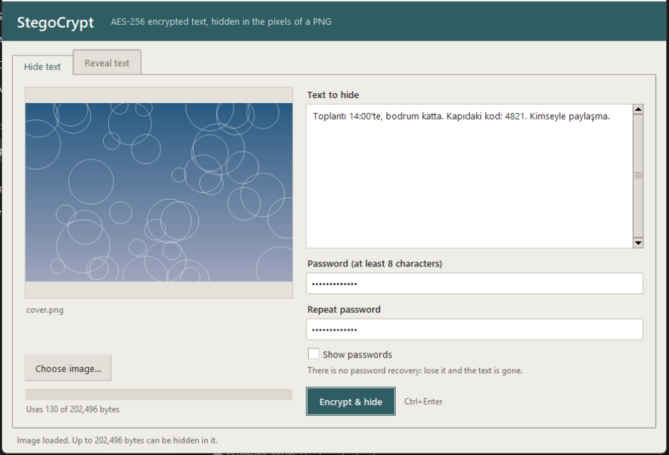
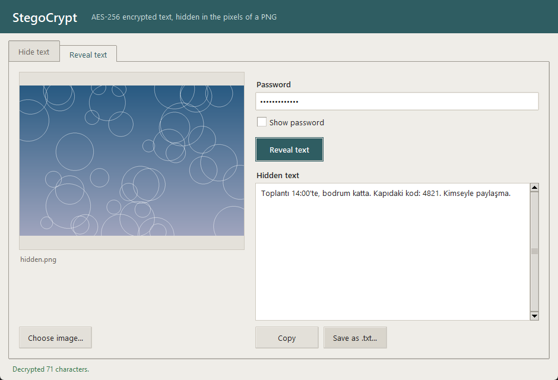

# ENCRYPT-TEXT (StegoCrypt)

Hide a text message inside a PNG image. The text is encrypted with **AES-256** under a password you choose, and the result is written into the image's pixels. Without the password, the image is just an image.

| Hide text | Reveal text |
|---|---|
|  |  |

## Quick start

Requires Python 3.9+ (tkinter ships with the standard Windows/macOS installers; on Debian/Ubuntu: `sudo apt install python3-tk`).

```bash
git clone https://github.com/mehdiuslu/ENCRYPT-TEXT.git
cd ENCRYPT-TEXT
python -m pip install -r requirements.txt
python main.py            # on Windows: py main.py
```

**Hide:** choose a cover image → type the text → set a password (twice) → *Encrypt & hide*. A new PNG is written; your original is never touched.
**Reveal:** choose that PNG → enter the password → *Reveal text*.

The capacity bar shows how much of the image the message uses. Share the result **as a file**: messengers that re-compress photos (JPEG) destroy the hidden data.

## How it works

1. **Key derivation:** PBKDF2-HMAC-SHA256, 600 000 iterations, random 16-byte salt.
2. **Encryption:** AES-256 in EAX mode (authenticated). A wrong password or a modified image is detected, not silently decoded to garbage.
3. **Hiding:** the encrypted blob is written into the least-significant bit of the R, G and B channels (1 bit per channel, alpha untouched), so no pixel value changes by more than 1.

Hidden data layout: `length(4) | "SGC2"(4) | iterations(4) | salt(16) | nonce(16) | tag(16) | ciphertext`. Images made by the first version of this tool are still readable.

The crypto and image code live in `core.py` (no GUI), so they can be used or tested on their own:

```python
import core
core.encrypt_into_image("cover.jpg", "meet at noon", "a long password", "hidden.png")
print(core.decrypt_from_image("hidden.png", "a long password"))
```

## Tests

```bash
python -m unittest -v     # 13 tests: round-trips (RGB/RGBA/L/P), wrong password, tampering,
                          # capacity limits, backward compatibility, malformed input
```

## Honest limitations

- **Encryption is strong; hiding is not stealthy.** Plain LSB embedding fills the first pixels sequentially and is detectable by statistical steganalysis. Anyone who suspects the image can tell *something* is in it — they just can't read it. If hiding the *existence* of the message matters, this is not enough.
- **Lossless formats only.** Output is always PNG. Re-saving as JPEG, resizing, or screenshotting destroys the data.
- **No password recovery.** The password is not stored anywhere.
- It has not been independently audited. Use a long, unique password.

## Changes in this version

- Rebuilt the GUI: one window with two tabs, live capacity bar, password confirmation and show/hide, clear error messages.
- Fixed: the two separate windows shared one image path, so using both mixed up files.
- Fixed: passwords were silently trimmed of leading/trailing spaces.
- Fixed: very slow, memory-hungry embedding (a Python list of every pixel and bit); now works on raw bytes.
- Hardened: PBKDF2 iterations 200 000 → 600 000 (stored in the file, old images still open), refuses absurd iteration counts from crafted images, minimum password 8 characters.
- Removed the old `text.py` / `imagine.py` / `hash.py` three-step scripts. They did not run (`NameError`), and by design stored the AES key *inside* the image next to the ciphertext, so the "verification code" protected nothing.

## License

MIT — see [LICENSE](LICENSE).
